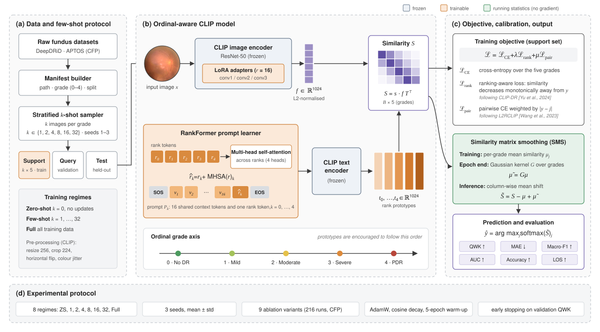
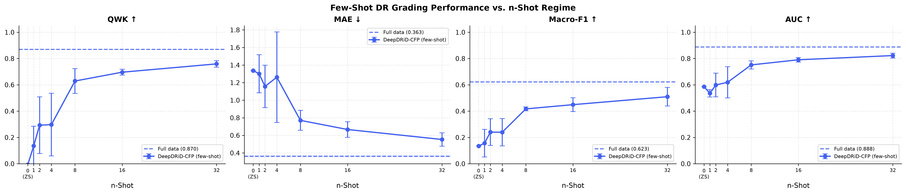
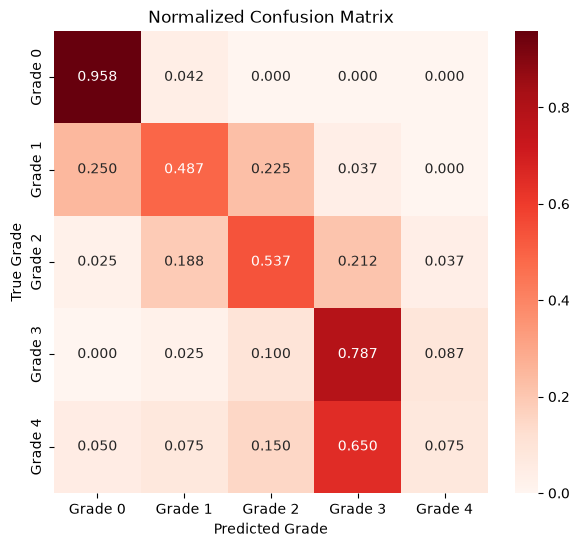
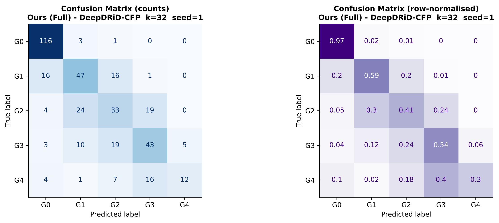
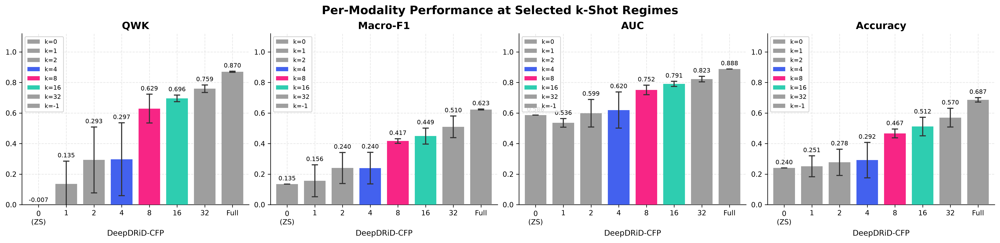

<div align="center">

# Few-Shot Ordinal-Aware CLIP for Diabetic Retinopathy Grading

**Parameter-efficient vision–language adaptation that respects the order of DR severity grades — from zero-shot to full supervision.**

[](https://www.python.org/)
[](https://pytorch.org/)
[](https://lightning.ai/)
[](https://github.com/openai/CLIP)
[](https://github.com/huggingface/peft)
[](#)

[Overview](#-overview) · [Framework](#-framework) · [Results](#-results) · [Getting started](#-getting-started) · [Reproduce](#-reproducing-the-paper-experiments) · [Acknowledgements](#-acknowledgements--references)

</div>

---

## 🔭 Overview

Diabetic retinopathy (DR) is graded on an **ordinal** five-level scale (No DR → Mild → Moderate → Severe → Proliferative). Mistaking grade 1 for grade 2 is far less harmful than mistaking grade 0 for grade 4, yet most classifiers treat the grades as unrelated categories. Labelled fundus images are also costly to collect, so a practical grading model has to learn from **very few examples per grade**.

This repository adapts a frozen **CLIP** model to few-shot ordinal DR grading with four lightweight components:

| | Component | What it does | Trainable? |
|---|---|---|---|
| 🧩 | **LoRA image adapters** | Low-rank updates (r = 16) on the conv layers of the frozen CLIP ResNet-50 | ✅ |
| 🔗 | **RankFormer prompt learner** | 16 shared context tokens + 5 rank tokens; multi-head self-attention lets rank tokens exchange ordinal context before the frozen text encoder | ✅ |
| 📐 | **Ordinal objective** | Cross-entropy + ranking-aware loss (monotonic similarity around the true grade) + cross-modal pairwise loss weighted by grade distance | — |
| 🌊 | **Similarity Matrix Smoothing (SMS)** | Gaussian-kernel smoothing of per-grade similarity statistics, then a column-wise mean shift at inference | statistics only |

The model is evaluated across **8 data regimes** (zero-shot, 1/2/4/8/16/32-shot and full training), **3 seeds** and **9 ablation variants** on DeepDRiD (CFP).

---

## 🧠 Framework

<p align="center">
  
</p>

<details open>
<summary><b>Block-by-block walkthrough</b></summary>

**(a) Data & few-shot protocol**
- `scripts/prepare_external_datasets.py` turns the raw DeepDRiD / APTOS folders into a standard `CFP_manifest.csv` (`path, modality, grade, lesion, lr, split`).
- `src/data/build_splits.py` draws a **stratified support set** of *k* images per grade for every (*k*, seed) pair. The remaining training images form the **query set**, which is used for validation and early stopping. The official split is kept as the **held-out test set**.
- `k = 0` is zero-shot (no parameter updates); `k = −1` uses the full training set.

**(b) Ordinal-aware CLIP model** (`src/models/runner.py`)
- **Image branch.** Each fundus image goes through the CLIP ResNet-50 visual encoder. The backbone stays frozen and only the LoRA adapters on `conv1/2/3` are trained (`src/models/lora_adapter.py`). This branch outputs an L2-normalised feature `f ∈ ℝ¹⁰²⁴`.
- **Text branch.** `RankFormerPromptLearner` (`src/models/prompt_learner/rankformer.py`) builds one prompt per grade: `[SOS] v₁ … v₁₆ r̂ₖ [EOS]`. The rank tokens are refined by self-attention, `r̂ = r + MHSA(r)`, so neighbouring grades share context. The frozen CLIP text encoder turns each prompt into a **rank prototype** `tₖ`.
- **Similarity.** `S = s · f tᵀ ∈ ℝ^{B×5}`, where `s` is CLIP's learned logit scale (clamped at 100).

**(c) Objective, calibration & output**
- `ℒ = ℒ_CE + λ·ℒ_rank + μ·ℒ_pair` (`src/models/losses.py`)
  - `ℒ_rank`, the **ranking-aware loss** (after CLIP-DR): for a sample of grade *y*, similarities must decrease monotonically to the left and to the right of *y*.
  - `ℒ_pair`, the **cross-modal pairwise loss** (after L2RCLIP): penalises an image for being closer to a wrong-grade prototype, weighted by `|y − j|`.
- **SMS** (`src/models/sms.py`) accumulates per-grade mean similarities `μ` during training and smooths them across grades with a Gaussian kernel, `μ̃ = Kμ`. At inference it calibrates `S̃ = S − μ + μ̃`.
- Prediction: `ŷ = argmax softmax(S̃)`. Metrics: **QWK, MAE, Macro-F1, AUC, Accuracy** and **LOS** (Local Ordinality Score: the share of predictions whose probability is a local peak over the neighbouring grades).

**(d) Experimental protocol**: AdamW (lr 1e-4, wd 1e-4), cosine schedule with a 5-epoch warm-up, early stopping on validation QWK, 16-bit mixed precision. Results are reported as mean ± std over seeds.

</details>

---

## 📊 Results

> DeepDRiD · CFP · 5 grades · mean ± std over 3 seeds. All numbers come from `results/main_results.csv` and `results/ablation_results.csv`, produced by [`notebooks/DeepDRiD_FewShot_DR_fixed.ipynb`](notebooks/DeepDRiD_FewShot_DR_fixed.ipynb).

### Performance vs. number of shots (full model)

| Regime | QWK ↑ | MAE ↓ | Macro-F1 ↑ | AUC ↑ | Acc ↑ |
|:--|:--:|:--:|:--:|:--:|:--:|
| Zero-shot | −0.007 | 1.338 | 0.135 | 0.586 | 0.240 |
| 1-shot | 0.135 ± 0.150 | 1.301 ± 0.216 | 0.157 ± 0.105 | 0.536 ± 0.028 | 0.251 ± 0.069 |
| 2-shot | 0.293 ± 0.216 | 1.157 ± 0.242 | 0.240 ± 0.102 | 0.599 ± 0.090 | 0.278 ± 0.086 |
| 4-shot | 0.297 ± 0.238 | 1.262 ± 0.515 | 0.240 ± 0.104 | 0.620 ± 0.119 | 0.292 ± 0.116 |
| 8-shot | 0.629 ± 0.094 | 0.771 ± 0.113 | 0.417 ± 0.015 | 0.752 ± 0.031 | 0.467 ± 0.029 |
| 16-shot | 0.696 ± 0.022 | 0.667 ± 0.089 | 0.449 ± 0.053 | 0.791 ± 0.017 | 0.512 ± 0.061 |
| 32-shot | 0.759 ± 0.025 | 0.553 ± 0.076 | 0.510 ± 0.071 | 0.823 ± 0.018 | 0.570 ± 0.061 |
| **Full** | **0.870 ± 0.004** | **0.363 ± 0.015** | **0.623 ± 0.003** | **0.888 ± 0.000** | **0.687 ± 0.014** |

<p align="center"></p>
<p align="center"><sub>Solid line: few-shot regimes (mean ± std over 3 seeds). Dashed line and band: the same model trained on the full training set.</sub></p>

### Confusion matrices: OrdinalCLIP baseline vs. ours

<table>
  <tr>
    <th align="center">OrdinalCLIP baseline</th>
    <th align="center">Ours (Full), 32-shot, seed 1</th>
  </tr>
  <tr>
    <td align="center" width="38%"></td>
    <td align="center" width="62%"></td>
  </tr>
</table>

Our model trains on only 32 images per grade, yet most of its errors fall on the grades next to the true one, close to the diagonal. Grade 4 is still often predicted as grade 3, the same weakness the OrdinalCLIP baseline shows.

### Ablation study

✅ = component on. Best value per column in **bold**.

| Variant | LoRA | RankFormer | ℒ_rank | ℒ_pair | SMS | QWK@16 | QWK@32 | QWK@Full | MAE@32 ↓ | AUC@32 | LOS@32 |
|:--|:-:|:-:|:-:|:-:|:-:|:-:|:-:|:-:|:-:|:-:|:-:|
| Baseline (OrdinalCLIP-style) | | | | | | 0.615 | 0.664 | 0.769 | 0.700 | 0.781 | 0.891 |
| Just LoRA | ✅ | | | | | 0.699 | 0.741 | 0.851 | 0.578 | 0.817 | 0.988 |
| LoRA + ℒ_rank | ✅ | | ✅ | | | 0.715 | 0.749 | 0.867 | 0.564 | 0.822 | 0.978 |
| w/o LoRA | | ✅ | ✅ | ✅ | ✅ | 0.490 | 0.691 | 0.775 | 0.652 | 0.789 | **1.000** |
| w/o RankFormer | ✅ | | ✅ | ✅ | ✅ | **0.734** | **0.771** | 0.862 | **0.552** | 0.829 | **1.000** |
| w/o ℒ_rank | ✅ | ✅ | | ✅ | ✅ | 0.673 | 0.747 | **0.870** | 0.578 | 0.813 | **1.000** |
| w/o ℒ_pair | ✅ | ✅ | ✅ | | ✅ | 0.702 | 0.750 | 0.847 | 0.561 | **0.832** | **1.000** |
| w/o SMS | ✅ | ✅ | ✅ | ✅ | | 0.690 | 0.759 | 0.861 | 0.563 | 0.820 | 0.979 |
| **Ours (Full)** | ✅ | ✅ | ✅ | ✅ | ✅ | 0.696 | 0.759 | **0.870** | 0.553 | 0.823 | **1.000** |

**Takeaways**
- **LoRA gives the largest single gain.** Over the baseline it adds +0.08 QWK at 32-shot and +0.08 at full data. Removing it causes the largest drop of any ablation.
- **The ordinal components produce well-ordered predictions.** Every variant that keeps the pairwise loss and SMS reaches LOS = 1.0, so every predicted grade is a local probability peak. The baseline reaches 0.89.
- **RankFormer does not help yet.** In the current runs, replacing RankFormer with OrdinalCLIP's interpolated rank head gives slightly better QWK at 16 and 32 shots. The prompt learner is still being tuned.

<p align="center"></p>

---

## 🗂️ Repository structure

```text
.
├── assets/                     # README figures (framework diagram, result plots)
├── configs/
│   ├── default.yaml            # full model: LoRA + RankFormer + ℒ_rank + ℒ_pair + SMS
│   ├── deepdrid_cfp.yaml       # DeepDRiD (CFP) dataset config
│   ├── aptos_cfp.yaml          # APTOS (CFP) dataset config
│   ├── mrdr_{cfp,oct,uwf}.yaml # MMRDR single-modality configs
│   ├── mmrdr_multimodal.yaml   # MSO-CLIP multi-modal config (work in progress)
│   └── baselines/              # OrdinalCLIP / CoOp+LoRA / L2RCLIP / CLIP-DR style baselines
├── notebooks/
│   └── DeepDRiD_FewShot_DR_fixed.ipynb   # ⭐ main end-to-end pipeline (data → train → ablate → plots)
├── scripts/
│   ├── prepare_external_datasets.py      # raw DeepDRiD / APTOS → CFP_manifest.csv
│   ├── prepare_mmrdr.py                  # MMRDR manifests
│   ├── train.py                          # single run (config + dot-overrides)
│   ├── sweep.py                          # k-shot × seed sweep
│   └── evaluate.py
├── src/
│   ├── data/                   # manifests, stratified k-shot splits, Lightning DataModules
│   └── models/
│       ├── clip_backbone.py    # CLIP loader + prompt-driven text encoder
│       ├── lora_adapter.py     # LoRA injection & freezing
│       ├── prompt_learner/     # RankFormer, OrdinalCLIP head (ablation)
│       ├── losses.py           # ranking-aware loss, cross-modal pairwise loss
│       ├── sms.py              # Similarity Matrix Smoothing
│       ├── runner.py           # FewShotOrdinalRunner (LightningModule)
│       └── mso_clip_runner.py  # multi-modal extension (CFP + OCT + UWF)
└── tests/                      # unit tests for losses, SMS, sampler, splits, ordinality
```

---

## 🚀 Getting started

```bash
git clone https://github.com/MohammadMahdi-Sharifbeigy/fewshot-ordinal-clip-dr.git
cd fewshot-ordinal-clip-dr

conda env create -f environment.yaml      # Python 3.13, PyTorch 2.8, CUDA 12.6
conda activate fs_ordinal
pip install -e .
```

### Data

Datasets are **not** redistributed here. Download them from their official sources:

| Dataset | Modality | Grades | Source |
|---|---|---|---|
| DeepDRiD | CFP | 0–4 | [DeepDRiD challenge](https://github.com/deepdrdoc/DeepDRiD) |
| APTOS 2019 | CFP | 0–4 | [Kaggle](https://www.kaggle.com/c/aptos2019-blindness-detection) |

Then build the manifests and the few-shot splits:

```bash
python scripts/prepare_external_datasets.py --deepdrid /path/to/DeepDRiD --aptos /path/to/APTOS
python src/data/build_splits.py --dataset DeepDRiD --modality CFP --kshots 1,2,4,8,16,32 --seeds 1,2,3
```

---

## 🧪 Reproducing the paper experiments

**Recommended:** run [`notebooks/DeepDRiD_FewShot_DR_fixed.ipynb`](notebooks/DeepDRiD_FewShot_DR_fixed.ipynb) from top to bottom. It builds the manifest and splits, trains the full grid and every ablation (finished runs are cached), aggregates mean ± std tables, and exports figures to `results/figures/`.

**From the command line:**

```bash
# one run
python scripts/train.py --config configs/deepdrid_cfp.yaml data.k_shot=16 data.seed=1

# the whole k-shot × seed sweep
python scripts/sweep.py --config configs/deepdrid_cfp.yaml --kshots 1,2,4,8,16,32 --seeds 1,2,3

# ablations are plain config overrides, e.g. "w/o RankFormer"
python scripts/train.py --config configs/deepdrid_cfp.yaml data.k_shot=16 \
       model.prompt_learner.name=ordinalclip_rank_prompt_learner
```

| Ablation | Overrides |
|---|---|
| w/o RankFormer | `model.prompt_learner.name=ordinalclip_rank_prompt_learner` |
| w/o SMS | `model.sms.enabled=false` |
| w/o ℒ_pair | `loss.mu_pairwise=0.0` |
| w/o ℒ_rank | `loss.lambda_rank=0.0` |
| w/o LoRA | `model.image_encoder.lora.enabled=false` |

Each run writes `results/<variant>/<MOD>_<k>shot_s<seed>/{best.ckpt,test_stats.json}`.

```bash
pytest tests/        # unit tests for losses, SMS, sampler and splits
```

---

## 🔬 Work in progress: MSO-CLIP (multi-modal)

`src/models/mso_clip_runner.py` extends the framework to the **MMRDR** dataset, which provides three modalities per patient: CFP, OCT and UWF. Each modality gets its own LoRA adapter on a shared frozen backbone. Two RankFormers produce prototypes for the two grading scales (5 grades for CFP/UWF, 3 grades for OCT). A cross-modal Transformer fuses the three visual tokens into one patient-level vector and uses a learned `[MISSING]` embedding for absent modalities. Training combines the unimodal losses with a patient-level ordinal loss.

---

## 🙏 Acknowledgements & references

This work builds on the ideas and open-source code below. The third-party repositories we studied or reproduced as baselines are **not** included here; please use the original sources.

| Work | Used for | Code |
|---|---|---|
| **CLIP**, Radford et al., ICML 2021 | Frozen vision–language backbone | [openai/CLIP](https://github.com/openai/CLIP) |
| **CLIP-DR**, Yu et al., MICCAI 2024 | Ranking-aware prompting loss, SMS; baseline | [Qinkaiyu/CLIP-DR](https://github.com/Qinkaiyu/CLIP-DR) |
| **OrdinalCLIP**, Li et al., NeurIPS 2022 | Learnable rank prompts; baseline / ablation head | [xk-huang/OrdinalCLIP](https://github.com/xk-huang/OrdinalCLIP) |
| **L2RCLIP**, Wang et al., NeurIPS 2023 | Cross-modal pairwise ordinal loss, RankFormer idea | [raywang335/L2RCLIP](https://github.com/raywang335/L2RCLIP) |
| **Ordinal DR Grading**, Stelter et al., NLDL 2026 (submitted) | Ordinal DR grading reference & data splits | [Trustworthy-AI-UU-NKI/Ordinal-DR-Grading](https://github.com/Trustworthy-AI-UU-NKI/Ordinal-DR-Grading) |
| **LoRA**, Hu et al., ICLR 2022 | Parameter-efficient adaptation | [huggingface/peft](https://github.com/huggingface/peft) |
| **DeepDRiD**, Liu et al., Patterns 2022 | Benchmark dataset | [deepdrdoc/DeepDRiD](https://github.com/deepdrdoc/DeepDRiD) |

<details>
<summary><b>BibTeX</b></summary>

```bibtex
@inproceedings{radford2021clip,
  title     = {Learning Transferable Visual Models From Natural Language Supervision},
  author    = {Radford, Alec and Kim, Jong Wook and Hallacy, Chris and Ramesh, Aditya and Goh, Gabriel and Agarwal, Sandhini and Sastry, Girish and Askell, Amanda and Mishkin, Pamela and Clark, Jack and Krueger, Gretchen and Sutskever, Ilya},
  booktitle = {International Conference on Machine Learning (ICML)},
  year      = {2021}
}

@inproceedings{yu2024clipdr,
  title     = {{CLIP-DR}: Textual Knowledge-Guided Diabetic Retinopathy Grading with Ranking-aware Prompting},
  author    = {Yu, Qinkai and Xie, Jianyang and Nguyen, Anh and Zhao, He and Zhang, Jiong and Fu, Huazhu and Zhao, Yitian and Zheng, Yalin and Meng, Yanda},
  booktitle = {Medical Image Computing and Computer Assisted Intervention (MICCAI)},
  year      = {2024}
}

@inproceedings{li2022ordinalclip,
  title     = {{OrdinalCLIP}: Learning Rank Prompts for Language-Guided Ordinal Regression},
  author    = {Li, Wanhua and Huang, Xiaoke and Zhu, Zheng and Tang, Yansong and Li, Xiu and Lu, Jiwen and Zhou, Jie},
  booktitle = {Advances in Neural Information Processing Systems (NeurIPS)},
  year      = {2022}
}

@inproceedings{wang2023l2rclip,
  title     = {Learning-to-Rank Meets Language: Boosting Language-Driven Ordering Alignment for Ordinal Classification},
  author    = {Wang, Rui and Li, Peipei and Huang, Huaibo and Cao, Chunshui and He, Ran and He, Zhaofeng},
  booktitle = {Advances in Neural Information Processing Systems (NeurIPS)},
  year      = {2023}
}

@inproceedings{hu2022lora,
  title     = {{LoRA}: Low-Rank Adaptation of Large Language Models},
  author    = {Hu, Edward J. and Shen, Yelong and Wallis, Phillip and Allen-Zhu, Zeyuan and Li, Yuanzhi and Wang, Shean and Wang, Lu and Chen, Weizhu},
  booktitle = {International Conference on Learning Representations (ICLR)},
  year      = {2022}
}

@article{liu2022deepdrid,
  title   = {{DeepDRiD}: Diabetic Retinopathy -- Grading and Image Quality Estimation Challenge},
  author  = {Liu, Ruhan and Wang, Xiangning and Wu, Qiang and Dai, Ling and Fang, Xi and Yan, Tao and others},
  journal = {Patterns},
  volume  = {3},
  number  = {6},
  year    = {2022}
}
```

</details>

## 📝 Citation

If this work is useful to you, please cite it. The BibTeX entry will be updated when the paper is published.

```bibtex
@misc{sharifbeigy2026fewshotordinaldr,
  title  = {Few-Shot Ordinal-Aware CLIP for Diabetic Retinopathy Grading},
  author = {Sharifbeigy, MohammadMahdi},
  year   = {2026},
  note   = {GitHub repository},
  url    = {https://github.com/MohammadMahdi-Sharifbeigy/fewshot-ordinal-clip-dr}
}
```
