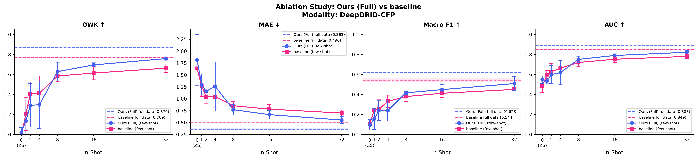

<div align="center">

# Few-Shot Ordinal-Aware CLIP for Diabetic Retinopathy Grading

**Parameter-efficient vision–language adaptation that respects the order of DR severity grades — from zero-shot to full supervision.**

[](https://www.python.org/)
[](https://pytorch.org/)
[](https://lightning.ai/)
[](https://github.com/openai/CLIP)
[](https://github.com/huggingface/peft)
[](#)

[Overview](#overview) · [Framework](#framework) · [Results](#results) · [Getting started](#getting-started) · [Reproduce](#reproducing-the-paper-experiments) · [Acknowledgements](#acknowledgements--references)

</div>

---

## Overview

Diabetic retinopathy (DR) is graded on an **ordinal** five-level scale (No DR → Mild → Moderate → Severe → Proliferative). Mistaking grade 1 for grade 2 is far less harmful than mistaking grade 0 for grade 4, yet most classifiers treat the grades as unrelated categories. Labelled fundus images are also costly to collect, so a practical grading model has to learn from **very few examples per grade**.

This repository adapts a frozen **CLIP** model to few-shot ordinal DR grading with four lightweight components:

| Component | What it does | Trainable |
|---|---|:-:|
| **LoRA image adapters** | Low-rank updates (r = 16) on the conv layers of the frozen CLIP ResNet-50 | yes |
| **Rank prompt learner** | 16 shared context tokens + 5 grade tokens interpolated from 3 learnable base tokens (OrdinalCLIP's weighting), through the frozen text encoder | yes |
| **Ordinal objective** | Cross-entropy + CLIP-DR's ranking-aware loss (similarity falls off monotonically around the true grade) | – |
| **Similarity Matrix Smoothing (SMS)** | CLIP-DR's smoothing in its FDS form: during training, each grade's similarity statistics (mean, variance) are smoothed over neighbouring grades and the training similarities re-normalised; nothing changes at inference | statistics only |

RankFormer (from the L2RCLIP paper, reimplemented: its repository has no model or training code) and our distance-weighted pairwise loss (inspired by L2RCLIP's cross-modal ordinal pairwise loss, not the same loss) are **not part of the main model**. They are available as `configs/ours_plus_l2rclip.yaml` (our model plus both) and `configs/baselines/l2rclip_ours_impl.yaml` (both on their own).

The model is evaluated across **8 data regimes** (zero-shot, 1/2/4/8/16/32-shot and full training), **3 seeds** and **9 ablation variants** on DeepDRiD (CFP).

---

## Framework

> **Note.** The figure, the block-by-block walkthrough and the results below describe the earlier main model (with RankFormer and the pairwise loss, trained before the per-eye labels and patient-grouped splits). They will be updated with the new runs.

<p align="center">
  
</p>

### Block-by-block walkthrough

**(a) Data & few-shot protocol**
- `scripts/prepare_external_datasets.py` turns the raw DeepDRiD / APTOS folders into a standard `CFP_manifest.csv` (`path, modality, grade, lesion, lr, split`).
- `src/data/build_splits.py` draws a **stratified support set** of *k* images per grade for every (*k*, seed) pair. The remaining training images form the **query set**, which is used for validation and early stopping. The official split is kept as the **held-out test set**.
- `k = 0` is zero-shot (no parameter updates); `k = −1` uses the full training set.

**(b) Ordinal-aware CLIP model** (`src/models/runner.py`)
- **Image branch.** Each fundus image goes through the CLIP ResNet-50 visual encoder. The backbone stays frozen and only the LoRA adapters on `conv1/2/3` are trained (`src/models/lora_adapter.py`). This branch outputs an L2-normalised feature $`f \in \mathbb{R}^{1024}`$.
- **Text branch.** `RankFormerPromptLearner` (`src/models/prompt_learner/rankformer.py`) builds one prompt per grade $`k \in \{0, \dots, 4\}`$ from 16 shared context tokens $`v_1, \dots, v_{16}`$ and a rank token. The rank tokens first attend to each other, so neighbouring grades share context:

```math
\hat{r} = r + \mathrm{MHSA}(r), \qquad P_k = \big[\,\mathrm{SOS},\ v_1, \dots, v_{16},\ \hat{r}_k,\ \mathrm{EOS}\,\big]
```

  The frozen CLIP text encoder maps each prompt $`P_k`$ to an L2-normalised **rank prototype** $`t_k`$.
- **Similarity.** With CLIP's learned logit scale $`s`$ (clamped at 100):

```math
S_{bk} = s \cdot f_b^{\top} t_k, \qquad S \in \mathbb{R}^{B \times 5}
```

**(c) Objective, calibration & output** (`src/models/losses.py`, `src/models/sms.py`)

The support set is trained with

```math
\mathcal{L} = \mathcal{L}_{\mathrm{CE}} + \lambda\, \mathcal{L}_{\mathrm{rank}} + \mu\, \mathcal{L}_{\mathrm{pair}}
```

- $`\mathcal{L}_{\mathrm{rank}}`$, the **ranking-aware loss** (after CLIP-DR). For a sample of grade $`y`$, similarities must rise up to $`y`$ and fall after it:

```math
\mathcal{L}_{\mathrm{rank}} = \sum_{j=1}^{y} -\log \sigma\!\left(\frac{S_j - S_{j-1}}{\tau}\right) \;+\; \sum_{j=y}^{K-2} -\log \sigma\!\left(\frac{S_j - S_{j+1}}{\tau}\right)
```

- $`\mathcal{L}_{\mathrm{pair}}`$, the **distance-weighted pairwise loss** (ours, inspired by L2RCLIP's cross-modal ordinal pairwise loss; optional, not in the main model). It penalises an image for being closer to a wrong-grade prototype, and the penalty grows with the grade distance:

```math
\mathcal{L}_{\mathrm{pair}} = \sum_{j \neq y} |y - j| \cdot \Big(-\log \sigma\big(z_y - z_j\big)\Big), \qquad z_j = \frac{f^{\top} t_j}{\tau}
```

- **SMS.** During training it records $`\mu_j`$, the mean similarity of training samples of grade $`j`$. At the end of each epoch it smooths these means across grades with a row-normalised Gaussian kernel $`G`$. At inference it shifts each column of $`S`$:

```math
\tilde{\mu} = G\,\mu, \qquad \tilde{S}_{:,j} = S_{:,j} - \mu_j + \tilde{\mu}_j
```

- **Prediction and metrics.** $`\hat{y} = \arg\max_j \, \mathrm{softmax}(\tilde{S})_j`$. Metrics: **QWK, MAE, Macro-F1, AUC, Accuracy** and **LOS**, the Local Ordinality Score. LOS is the share of predictions whose probability is a local peak over the neighbouring grades, $`p_{\hat{y}} > p_{\hat{y}-1}`$ and $`p_{\hat{y}} > p_{\hat{y}+1}`$.

**(d) Experimental protocol**: AdamW (lr 1e-4, wd 1e-4), cosine schedule with a 5-epoch warm-up, early stopping on validation QWK, 16-bit mixed precision. Results are reported as mean ± std over seeds.


---

## Results

> DeepDRiD · CFP · 5 grades · mean ± std over 3 seeds. All numbers come from `results/main_results.csv` and `results/ablation_results.csv`, produced by [`notebooks/DeepDRiD_FewShot_DR_fixed.ipynb`](notebooks/DeepDRiD_FewShot_DR_fixed.ipynb).

### Performance vs. number of shots (full model)

| Regime | QWK ↑ | MAE ↓ | Macro-F1 ↑ | AUC ↑ | Acc ↑ |
|:--|:--:|:--:|:--:|:--:|:--:|
| Zero-shot | −0.007 | 1.338 | 0.135 | 0.586 | 0.240 |
| 1-shot | 0.135 ± 0.150 | 1.301 ± 0.216 | 0.157 ± 0.105 | 0.536 ± 0.028 | 0.251 ± 0.069 |
| 2-shot | 0.293 ± 0.216 | 1.157 ± 0.242 | 0.240 ± 0.102 | 0.599 ± 0.090 | 0.278 ± 0.086 |
| 4-shot | 0.297 ± 0.238 | 1.262 ± 0.515 | 0.240 ± 0.104 | 0.620 ± 0.119 | 0.292 ± 0.116 |
| 8-shot | 0.629 ± 0.094 | 0.771 ± 0.113 | 0.417 ± 0.015 | 0.752 ± 0.031 | 0.467 ± 0.029 |
| 16-shot | 0.696 ± 0.022 | 0.667 ± 0.089 | 0.449 ± 0.053 | 0.791 ± 0.017 | 0.512 ± 0.061 |
| 32-shot | 0.759 ± 0.025 | 0.553 ± 0.076 | 0.510 ± 0.071 | 0.823 ± 0.018 | 0.570 ± 0.061 |
| **Full** | **0.870 ± 0.004** | **0.363 ± 0.015** | **0.623 ± 0.003** | **0.888 ± 0.000** | **0.687 ± 0.014** |

<p align="center"></p>
<p align="center"><sub>Ours (Full, blue) vs. the OrdinalCLIP-style baseline (pink). Solid lines: few-shot regimes (mean ± std over 3 seeds). Dashed lines and bands: each model trained on the full training set.</sub></p>

### Confusion matrices: OrdinalCLIP baseline vs. ours

<table>
  <tr>
    <th align="center">OrdinalCLIP baseline</th>
    <th align="center">Ours (Full), 32-shot, seed 1</th>
  </tr>
  <tr>
    <td align="center" width="50%"></td>
    <td align="center" width="50%"></td>
  </tr>
</table>

Trained on only 32 images per grade, our model keeps most of its errors on neighbouring grades. Compared with the baseline, it recognises proliferative DR (grade 4) more often: 0.300 vs. 0.075, with fewer of those cases pushed down to grade 3 (0.400 vs. 0.650). It is also better on grades 0 and 1. The baseline is stronger on grades 2 and 3.

### Ablation study

✓ = component on. Best value per column in **bold**.

| Variant | LoRA | RankFormer | $`\mathcal{L}_{\mathrm{rank}}`$ | $`\mathcal{L}_{\mathrm{pair}}`$ | SMS | QWK@16 | QWK@32 | QWK@Full | MAE@32 ↓ | AUC@32 | LOS@32 |
|:--|:-:|:-:|:-:|:-:|:-:|:-:|:-:|:-:|:-:|:-:|:-:|
| Baseline (OrdinalCLIP-style) | | | | | | 0.615 | 0.664 | 0.769 | 0.700 | 0.781 | 0.891 |
| Just LoRA | ✓ | | | | | 0.699 | 0.741 | 0.851 | 0.578 | 0.817 | 0.988 |
| LoRA + $`\mathcal{L}_{\mathrm{rank}}`$ | ✓ | | ✓ | | | 0.715 | 0.749 | 0.867 | 0.564 | 0.822 | 0.978 |
| w/o LoRA | | ✓ | ✓ | ✓ | ✓ | 0.490 | 0.691 | 0.775 | 0.652 | 0.789 | **1.000** |
| w/o RankFormer | ✓ | | ✓ | ✓ | ✓ | **0.734** | **0.771** | 0.862 | **0.552** | 0.829 | **1.000** |
| w/o $`\mathcal{L}_{\mathrm{rank}}`$ | ✓ | ✓ | | ✓ | ✓ | 0.673 | 0.747 | **0.870** | 0.578 | 0.813 | **1.000** |
| w/o $`\mathcal{L}_{\mathrm{pair}}`$ | ✓ | ✓ | ✓ | | ✓ | 0.702 | 0.750 | 0.847 | 0.561 | **0.832** | **1.000** |
| w/o SMS | ✓ | ✓ | ✓ | ✓ | | 0.690 | 0.759 | 0.861 | 0.563 | 0.820 | 0.979 |
| **Ours (Full)** | ✓ | ✓ | ✓ | ✓ | ✓ | 0.696 | 0.759 | **0.870** | 0.553 | 0.823 | **1.000** |

**Takeaways**
- **LoRA gives the largest single gain.** Over the baseline it adds +0.08 QWK at 32-shot and +0.08 at full data. Removing it causes the largest drop of any ablation.
- **The ordinal components produce well-ordered predictions.** Every variant that keeps the pairwise loss and SMS reaches LOS = 1.0, so every predicted grade is a local probability peak. The baseline reaches 0.89.
- **RankFormer does not help yet.** In the current runs, replacing RankFormer with OrdinalCLIP's interpolated rank head gives slightly better QWK at 16 and 32 shots. The prompt learner is still being tuned.

<p align="center"></p>

---

## Repository structure

```text
.
├── assets/                     # README figures (framework diagram, result plots)
├── configs/
│   ├── default.yaml            # main model: LoRA + OrdinalCLIP-style rank prompts + ranking loss + SMS
│   ├── deepdrid_cfp.yaml       # DeepDRiD (CFP) dataset config
│   ├── aptos_cfp.yaml          # APTOS (CFP) dataset config
│   ├── mrdr_{cfp,oct,uwf}.yaml # MMRDR single-modality configs
│   ├── mmrdr_multimodal.yaml   # MSO-CLIP multi-modal config (work in progress)
│   └── baselines/              # OrdinalCLIP, CLIP-DR (matched / official), L2RCLIP (our impl.)
├── notebooks/
│   └── DeepDRiD_FewShot_DR_fixed.ipynb   # main end-to-end pipeline (data → train → ablate → plots)
├── scripts/
│   ├── prepare_external_datasets.py      # raw DeepDRiD / APTOS → CFP_manifest.csv
│   ├── prepare_mmrdr.py                  # MMRDR manifests
│   ├── train.py                          # single run (config + dot-overrides)
│   ├── sweep.py                          # k-shot × seed sweep
│   └── evaluate.py
├── src/
│   ├── data/                   # manifests, stratified k-shot splits, Lightning DataModules
│   └── models/
│       ├── clip_backbone.py    # CLIP loader + prompt-driven text encoder
│       ├── lora_adapter.py     # LoRA injection & freezing
│       ├── prompt_learner/     # OrdinalCLIP / CLIP-DR rank head, RankFormer
│       ├── losses.py           # ranking-aware, OrdinalCLIP KL, distance-weighted pairwise
│       ├── sms.py              # Similarity Matrix Smoothing
│       ├── runner.py           # FewShotOrdinalRunner (LightningModule)
│       └── mso_clip_runner.py  # multi-modal extension (CFP + OCT + UWF)
└── tests/                      # unit tests for losses, SMS, sampler, splits, ordinality
```

---

## Getting started

```bash
git clone https://github.com/MohammadMahdi-Sharifbeigy/fewshot-ordinal-clip-dr.git
cd fewshot-ordinal-clip-dr

conda env create -f environment.yaml      # Python 3.13, PyTorch 2.8, CUDA 12.6
conda activate fs_ordinal
pip install -e .
```

### Data

Datasets are **not** redistributed here. Download them from their official sources:

| Dataset | Modality | Grades | Source |
|---|---|---|---|
| DeepDRiD | CFP | 0–4 | [DeepDRiD challenge](https://github.com/deepdrdoc/DeepDRiD) |
| APTOS 2019 | CFP | 0–4 | [Kaggle](https://www.kaggle.com/c/aptos2019-blindness-detection) |

Then build the manifests and the few-shot splits:

```bash
python scripts/prepare_external_datasets.py --deepdrid /path/to/DeepDRiD --aptos /path/to/APTOS
python src/data/build_splits.py --dataset DeepDRiD --modality CFP --kshots 1,2,4,8,16,32 --seeds 1,2,3
```

---

## Reproducing the paper experiments

**Recommended:** run [`notebooks/DeepDRiD_FewShot_DR_fixed.ipynb`](notebooks/DeepDRiD_FewShot_DR_fixed.ipynb) from top to bottom. It builds the manifest and splits, trains the full grid and every ablation (finished runs are cached), aggregates mean ± std tables, and exports figures to `results/figures/`.

**From the command line:**

```bash
# one run
python scripts/train.py --config configs/deepdrid_cfp.yaml data.k_shot=16 data.seed=1

# the whole k-shot × seed sweep
python scripts/sweep.py --config configs/deepdrid_cfp.yaml --kshots 1,2,4,8,16,32 --seeds 1,2,3

# ablations are plain config overrides, e.g. "w/o SMS"
python scripts/train.py --config configs/deepdrid_cfp.yaml data.k_shot=16 model.sms.enabled=false
```

| Variant | Config / overrides |
|---|---|
| w/o SMS | `model.sms.enabled=false` |
| w/o $`\mathcal{L}_{\mathrm{rank}}`$ | `loss.lambda_rank=0.0` |
| w/o LoRA | `model.image_encoder.lora.enabled=false` |
| Ours + L2RCLIP parts | `configs/ours_plus_l2rclip.yaml` |
| OrdinalCLIP (matched / official) | `configs/baselines/ordinalclip_matched.yaml`, `ordinalclip_official.yaml` |
| CLIP-DR (matched / official) | `configs/baselines/clipdr_matched.yaml`, `clipdr_official.yaml` |
| L2RCLIP (our impl.) | `configs/baselines/l2rclip_ours_impl.yaml` |

Each run writes `results/<variant>/<MOD>_<k>shot_s<seed>/{best.ckpt,test_stats.json}`.

```bash
pytest tests/        # unit tests for losses, SMS, sampler and splits
```

`scripts/train.py` uses `bf16-mixed` when the GPU supports it and `32-true` otherwise; set `train.precision` to override. fp16 is avoided because the CLIP RN50 visual tower overflows to NaN under fp16 autocast.

---

## Direction 1: direct ordinal-geometry text embeddings (branch `direction1-ordinal-geometry`)

This direction replaces the prompt learner with five grade embeddings $`t_0, \dots, t_4`$ that live directly in CLIP's joint space (`src/models/prompt_learner/ordinal_geometry.py`).

**How the embeddings are built and trained**
- Each embedding starts from a grade sentence encoded once by the frozen text encoder: ICDR clinical definitions by default, plain grade names, or random orthonormal vectors.
- The embeddings are kept on the unit sphere and trained end-to-end with LoRA.
- Three geometry losses (`src/models/geometry_losses.py`) enforce the grade order:
  - a **distance ladder**: distance grows with the grade gap, with margin $`m`$;
  - a **smooth path**: second-order smoothness plus step alignment;
  - a per-grade **anchor** back to the initial text.

**Metrics.** Every run also reports the confusion matrix, ECE, and **ODC** (Ordinal Decay Consistency, `src/utils/ordinal_metrics.py`). ODC measures whether error mass decreases monotonically away from the diagonal in each row of the confusion matrix, in two variants: `odc_full` and `odc_offdiag`. Direct-embedding runs also write per-epoch geometry diagnostics to `geometry.json`.

**Configs**
- **Main method:** `configs/direction1/d1_full.yaml` (CE + CLIP-DR ranking + SMS + geometry). `d1_plus_pairwise` adds our distance-weighted pairwise loss (inspired by L2RCLIP).
- **Ablations** (`configs/direction1/`):
  - `d1_ce_geometry`, `d1_no_geometry`;
  - `d1_no_ladder`, `d1_no_path`, `d1_no_anchor`;
  - `d1_init_plain`, `d1_init_random`;
  - `d1_anchor_invsqrt` (λ from DeepDRiD training-split prevalence);
  - `d1_rankformer` (the earlier prompt-based model with the L2RCLIP parts, = `configs/ours_plus_l2rclip.yaml`).
- **Matched baselines** (LoRA r = 16, same recipe), in `configs/baselines/`: `clipdr_matched` (checked against CLIP-DR's code), `l2rclip_ours_impl` (L2RCLIP from the paper: RankFormer + our pairwise loss; its repository has no model or training code), `clap_matched`.
- **Native-recipe baselines:** `clipdr_official`, `ordinalclip_official`, `clap_native`.

Design and plan: `docs/superpowers/specs/2026-10-17-direction1-ordinal-geometry-design.md`, `docs/superpowers/plans/2026-10-17-direction1-ordinal-geometry.md`.

```bash
python scripts/sweep.py --config configs/direction1/d1_full.yaml --kshots 0,1,2,4,8,16,32,-1 --seeds 1,2,3 \
       --extra "data.manifest=<abs>/CFP_manifest.csv" "data.splits_dir=<abs>/splits"
```

---

## Direction 2: ordinal text-encoder LoRA (branch `direction2-ordinal-text-lora`)

Here the grade prompts stay in clinical language and CLIP's **text encoder** is adapted with LoRA, instead of learning prompt tokens or free grade vectors.

**How the grade embeddings are built and trained**
- Each grade has five ICDR-based descriptions (`src/models/prompt_learner/text_lora_prototypes.py`). The grade prototype is the normalised mean of its description embeddings.
- LoRA (`src/models/text_lora.py`) adds low-rank updates to q, k, v of all 12 text-transformer layers (CLIP-LoRA defaults: r = 2, α = 1, dropout 0.25); the original weights stay frozen.
- Ordinal structure is enforced on the encoder's outputs:
  - the Direction 1 **ladder** on the prototypes;
  - **description ordering** (`src/models/text_losses.py`): every description is scored against all grades and must rank its own grade first and farther grades lower;
  - an **anchor** to the zero-shot prototypes.
- The image side and the image-text losses are the same as Direction 1.

**Configs**
- **Main method:** `configs/direction2/d2_full.yaml`.
- **Ablations** (`configs/direction2/`): `d2_no_ladder`, `d2_no_desc`, `d2_no_anchor`, `d2_no_ordinal_reg`, `d2_frozen_text`, `d2_single_prompt`, `d2_plain_prompts`, `d2_lora_r8`, `d2_lora_qkvo`.
- **Baselines** (`configs/baselines/`): `cliplora` (CLIP-LoRA: LoRA on both encoders, template prompt, CE only) and `cliplora_ordinal` (plus CLIP-DR ranking, L2RCLIP pairwise and SMS).

Notebook: [`notebooks/DeepDRiD_Direction2.ipynb`](notebooks/DeepDRiD_Direction2.ipynb). Design: `docs/superpowers/specs/2026-10-19-direction2-ordinal-text-lora-design.md`.

---

## Work in progress: MSO-CLIP (multi-modal)

`src/models/mso_clip_runner.py` extends the framework to the **MMRDR** dataset, which provides three modalities per patient: CFP, OCT and UWF. Each modality gets its own LoRA adapter on a shared frozen backbone. Two RankFormers produce prototypes for the two grading scales (5 grades for CFP/UWF, 3 grades for OCT). A cross-modal Transformer fuses the three visual tokens into one patient-level vector and uses a learned `[MISSING]` embedding for absent modalities. Training combines the unimodal losses with a patient-level ordinal loss.

---

## Acknowledgements & references

This work builds on the ideas and open-source code below. The third-party repositories we studied or reproduced as baselines are **not** included here; please use the original sources.

| Work | Used for | Code |
|---|---|---|
| **CLIP**, Radford et al., ICML 2021 | Frozen vision–language backbone | [openai/CLIP](https://github.com/openai/CLIP) |
| **CLIP-DR**, Yu et al., MICCAI 2024 | Ranking-aware loss, SMS, plain rank prompts; baseline | [Qinkaiyu/CLIP-DR](https://github.com/Qinkaiyu/CLIP-DR) |
| **OrdinalCLIP**, Li et al., NeurIPS 2022 | Learnable rank prompts; baseline / ablation head | [xk-huang/OrdinalCLIP](https://github.com/xk-huang/OrdinalCLIP) |
| **L2RCLIP**, Wang et al., NeurIPS 2023 | RankFormer (reimplemented from the paper; the repository has no model or training code) and the idea behind our distance-weighted pairwise loss; optional configs | [raywang335/L2RCLIP](https://github.com/raywang335/L2RCLIP) |
| **LoRA**, Hu et al., ICLR 2022 | Parameter-efficient adaptation | [huggingface/peft](https://github.com/huggingface/peft) |
| **DeepDRiD**, Liu et al., Patterns 2022 | Benchmark dataset | [deepdrdoc/DeepDRiD](https://github.com/deepdrdoc/DeepDRiD) |

<details>
<summary><b>BibTeX</b></summary>

```bibtex
@inproceedings{radford2021clip,
  title     = {Learning Transferable Visual Models From Natural Language Supervision},
  author    = {Radford, Alec and Kim, Jong Wook and Hallacy, Chris and Ramesh, Aditya and Goh, Gabriel and Agarwal, Sandhini and Sastry, Girish and Askell, Amanda and Mishkin, Pamela and Clark, Jack and Krueger, Gretchen and Sutskever, Ilya},
  booktitle = {International Conference on Machine Learning (ICML)},
  year      = {2021}
}

@inproceedings{yu2024clipdr,
  title     = {{CLIP-DR}: Textual Knowledge-Guided Diabetic Retinopathy Grading with Ranking-aware Prompting},
  author    = {Yu, Qinkai and Xie, Jianyang and Nguyen, Anh and Zhao, He and Zhang, Jiong and Fu, Huazhu and Zhao, Yitian and Zheng, Yalin and Meng, Yanda},
  booktitle = {Medical Image Computing and Computer Assisted Intervention (MICCAI)},
  year      = {2024}
}

@inproceedings{li2022ordinalclip,
  title     = {{OrdinalCLIP}: Learning Rank Prompts for Language-Guided Ordinal Regression},
  author    = {Li, Wanhua and Huang, Xiaoke and Zhu, Zheng and Tang, Yansong and Li, Xiu and Lu, Jiwen and Zhou, Jie},
  booktitle = {Advances in Neural Information Processing Systems (NeurIPS)},
  year      = {2022}
}

@inproceedings{wang2023l2rclip,
  title     = {Learning-to-Rank Meets Language: Boosting Language-Driven Ordering Alignment for Ordinal Classification},
  author    = {Wang, Rui and Li, Peipei and Huang, Huaibo and Cao, Chunshui and He, Ran and He, Zhaofeng},
  booktitle = {Advances in Neural Information Processing Systems (NeurIPS)},
  year      = {2023}
}

@inproceedings{hu2022lora,
  title     = {{LoRA}: Low-Rank Adaptation of Large Language Models},
  author    = {Hu, Edward J. and Shen, Yelong and Wallis, Phillip and Allen-Zhu, Zeyuan and Li, Yuanzhi and Wang, Shean and Wang, Lu and Chen, Weizhu},
  booktitle = {International Conference on Learning Representations (ICLR)},
  year      = {2022}
}

@article{liu2022deepdrid,
  title   = {{DeepDRiD}: Diabetic Retinopathy -- Grading and Image Quality Estimation Challenge},
  author  = {Liu, Ruhan and Wang, Xiangning and Wu, Qiang and Dai, Ling and Fang, Xi and Yan, Tao and others},
  journal = {Patterns},
  volume  = {3},
  number  = {6},
  year    = {2022}
}
```

</details>

## Citation

If this work is useful to you, please cite it. The BibTeX entry will be updated when the paper is published.

```bibtex
@misc{sharifbeigy2026fewshotordinaldr,
  title  = {Few-Shot Ordinal-Aware CLIP for Diabetic Retinopathy Grading},
  author = {Sharifbeigy, MohammadMahdi},
  year   = {2026},
  note   = {GitHub repository},
  url    = {https://github.com/MohammadMahdi-Sharifbeigy/fewshot-ordinal-clip-dr}
}
```
